# Day 2 – RTL Design, Hierarchical Synthesis and Sequential Logic

## 1. Objective

The objective of Day 2 was to understand multi-module RTL design, hierarchical synthesis, flattening of design hierarchy, technology mapping using the SKY130 standard cell library, and the implementation and simulation of sequential circuits.

The following concepts were covered:


- Liberty file exploration.
- Multi-module Verilog design.
- Module instantiation and port connections.
- Hierarchical synthesis using Yosys.
- Flat synthesis and netlist generation.
- Understanding synthesized netlists.
- Sequential circuit design using D Flip-Flops.
- Synchronous reset implementation.
- Functional verification using GTKWave.

---
### 2.Introduction

A standard cell library contains pre-designed and characterized logic cells used during digital IC design.

The SKY130 standard cell library provides cells such as:

- Inverters
- NAND and NOR gates
- AND and OR gates
- Multiplexers
- Flip-flops
- Buffers

### Liberty File (`.lib`)

The Liberty file contains information about the standard cells, including:

- Cell names and functionality
- Input and output pin information
- Timing characteristics
- Power information
- Area information
- Operating conditions

### PVT Conditions

PVT stands for:

- **Process:** Manufacturing variations.
- **Voltage:** Operating supply voltage.
- **Temperature:** Operating temperature.

These conditions affect the performance and timing of standard cells.


### Observation

The SKY130 library contains different standard cells with different area, power and timing characteristics. The Liberty file provides the information required by synthesis and timing analysis tools.

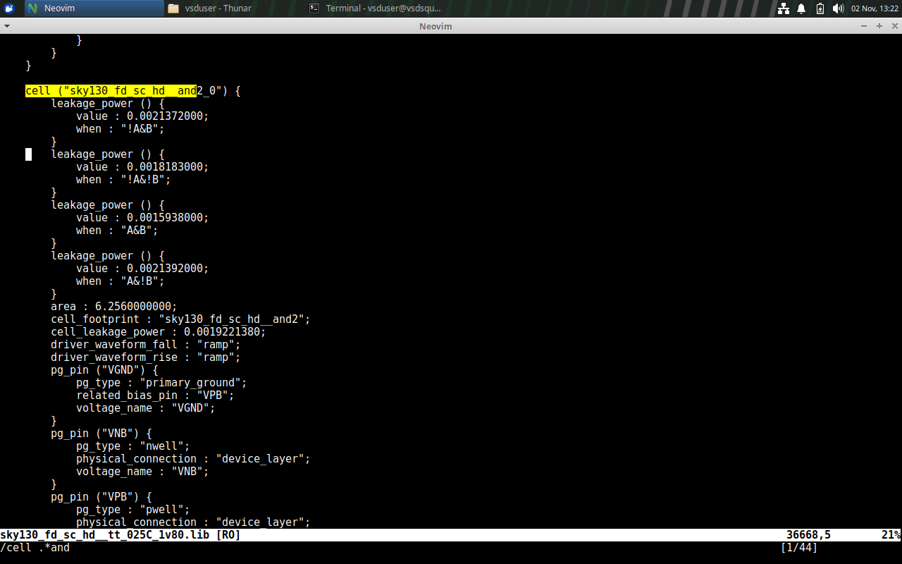

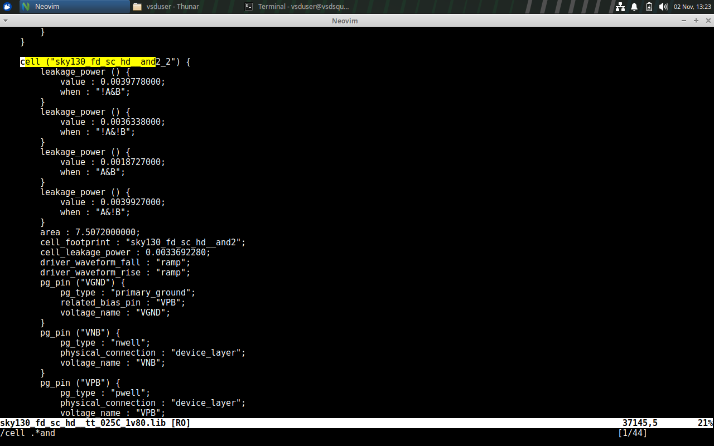
---
## 3. Multi-Module RTL Design

Multi-module design allows a large digital circuit to be divided into smaller, reusable modules.

Each module performs a specific operation, and these modules can be instantiated inside a top-level module.

### Verilog Code

**File: `multiple_modules.v`**

```verilog
module sub_module2 (input a, input b, output y);
    assign y = a | b;
endmodule

module sub_module1 (input a, input b, output y);
    assign y = a & b;
endmodule

module multiple_modules (input a, input b, input c, output y);

    wire net1;

    sub_module1 u1 (.a(a), .b(b), .y(net1));
    sub_module2 u2 (.a(net1), .b(c), .y(y));

endmodule
```

### Explanation

- `sub_module1` implements an AND operation.
- `sub_module2` implements an OR operation.
- `multiple_modules` is the top-level module.
- Instance `u1` connects the first submodule.
- Instance `u2` connects the second submodule.
- `net1` carries the output of the first module to the second module.

**Overall Boolean Expression:**

`Y = (A AND B) OR C`

### Hierarchical Design

The design hierarchy contains three modules:

1. `multiple_modules` – Top-level module.
2. `sub_module1` – AND operation.
3. `sub_module2` – OR operation.

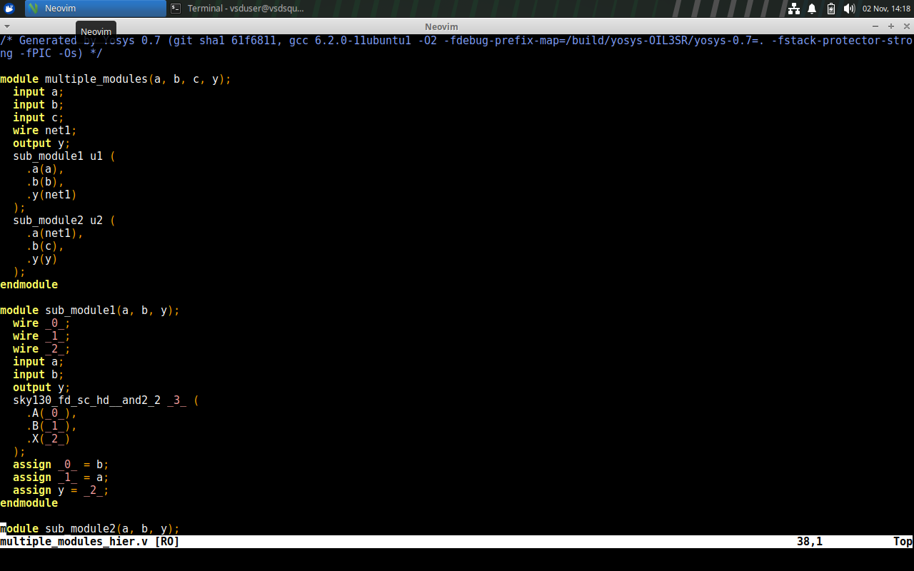
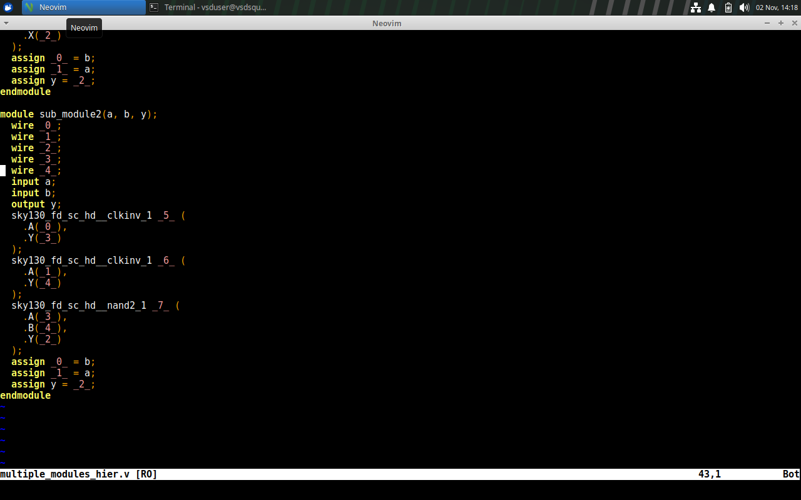


---

## 4. Yosys Synthesis

Yosys is an open-source synthesis tool used to convert RTL Verilog code into a gate-level netlist.

### Step 1: Start Yosys

```bash
yosys
```

### Step 2: Read the SKY130 Liberty File

```yosys
read_liberty -lib ../lib/sky130_fd_sc_hd__tt_025C_1v80.lib
```

The Liberty file contains information about the standard cells, including their functionality and timing characteristics.

### Step 3: Read the Verilog File

```yosys
read_verilog multiple_modules.v
```

### Step 4: Perform Hierarchical Synthesis

```yosys
synth -top multiple_modules
```

This command performs synthesis while maintaining the module hierarchy.


**Observed Result:**

`Found and reported 0 problems.`

### Step 5: Display the Synthesized Design

```yosys
show
```

The synthesized design can be viewed graphically.


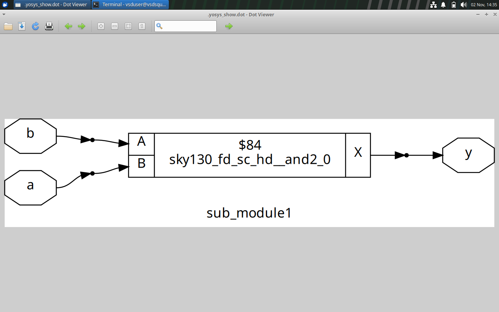
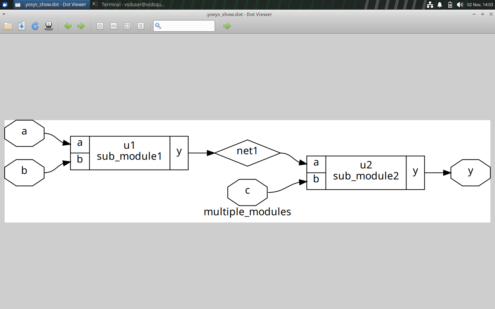

---

## 5. Understanding Hierarchical Synthesis

In hierarchical synthesis, the individual modules are synthesized while maintaining their structural relationships.

The top-level module contains instances of the submodules.

**Observed synthesis statistics:**

| Parameter | Observed Value |
|---|---:|
| Number of modules | 3 |
| Number of wires | 11 |
| Number of wire bits | 11 |
| Number of ports | 10 |
| Number of port bits | 10 |
| Number of cells | 2 |

The synthesized submodules contain:

- AND gate in `sub_module1`.
- OR gate in `sub_module2`.

This demonstrates how Yosys preserves the hierarchy of a multi-module design.

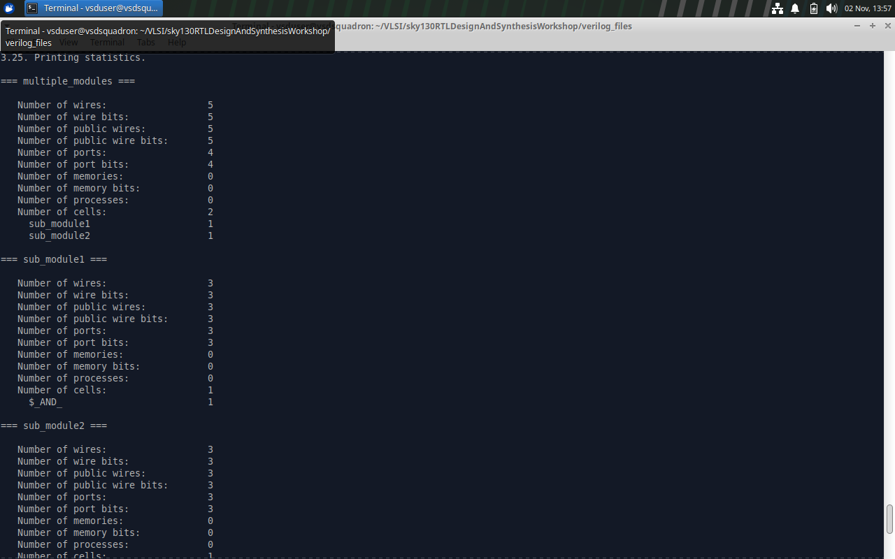
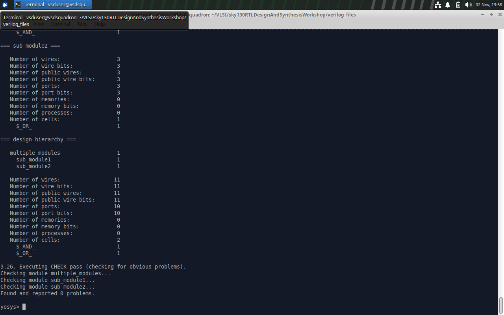
---

## 6. Flat Synthesis

Flat synthesis converts the hierarchical design into a single module by removing the submodule boundaries.

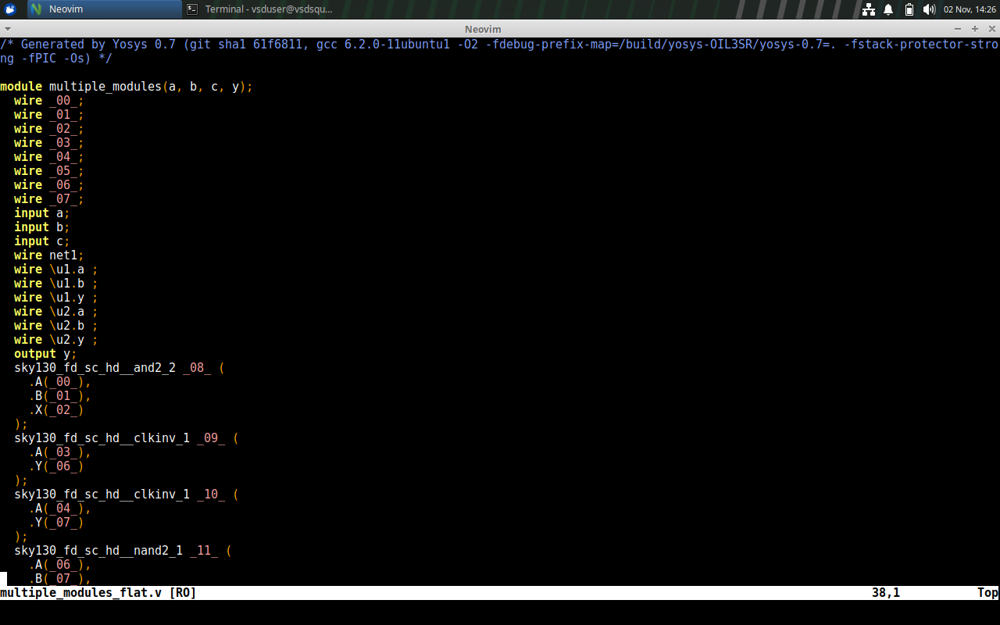
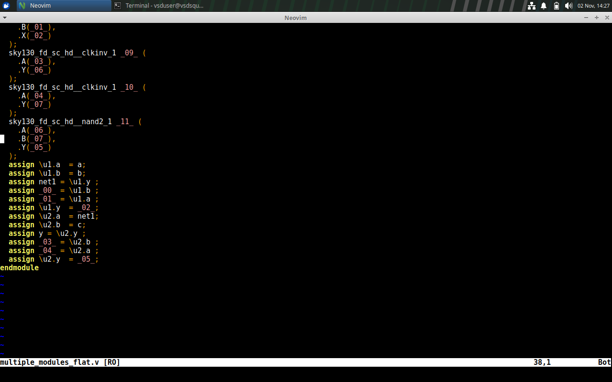
### Step 1: Read the Verilog File

```yosys
read_verilog multiple_modules.v
```

### Step 2: Perform Synthesis

```yosys
synth -top multiple_modules -flatten
```

The `-flatten` option removes the module hierarchy and combines the logic into the top-level module.


### Step 3: Generate the Flattened Netlist

```yosys
write_verilog -noattr multiple_modules_flat.v
```

### Step 4: View the Generated Netlist

```bash
gvim multiple_modules_flat.v
```

### Explanation

In flat synthesis:

- Submodule instances are removed.
- Internal connections are represented within the top-level module.
- The complete logic is available in one module.
- The resulting netlist is easier to examine as a single flattened design.


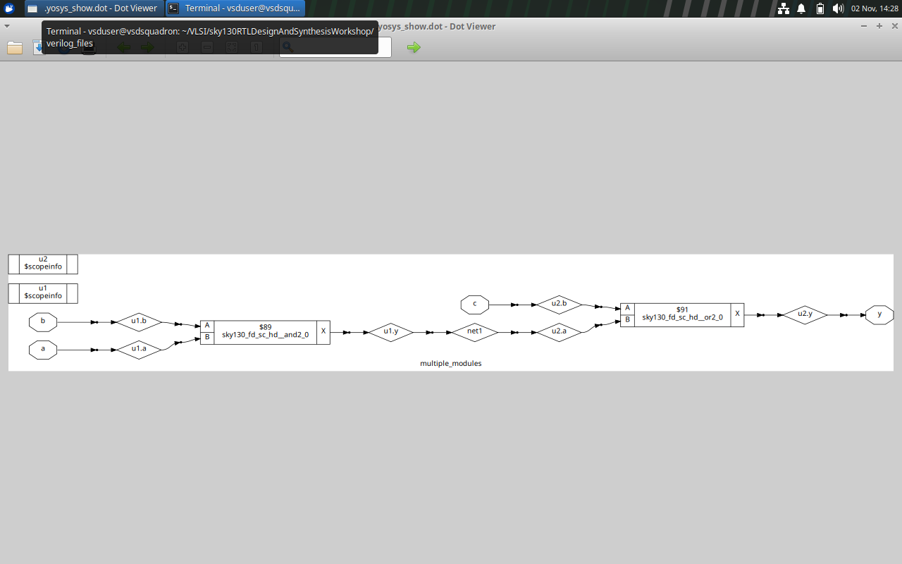

---


## 7. D Flip-Flop Experiments

### D Flip-Flop with Asynchronous Reset

### Testbench Code (`tb_dff_asyncres.v`)

```verilog
`timescale 1ns / 1ps
module tb_dff_asyncres;
    // Inputs
    reg clk, async_reset, d;
    // Outputs
    wire q;

    // Instantiate the Unit Under Test (UUT)
    dff_asyncres uut (
        .clk(clk),
        .async_reset(async_reset),
        .d(d),
        .q(q)
    );

    initial begin
        $dumpfile("tb_dff_asyncres.vcd");
        $dumpvars(0,tb_dff_asyncres);
        // Initialize Inputs
        clk = 0;
        async_reset = 1;
        d = 0;
        #3000 $finish;
    end

    always #10 clk = ~clk;
    always #23 d = ~d;
    always #547 async_reset=~async_reset;
endmodule
```

### Simulation Result

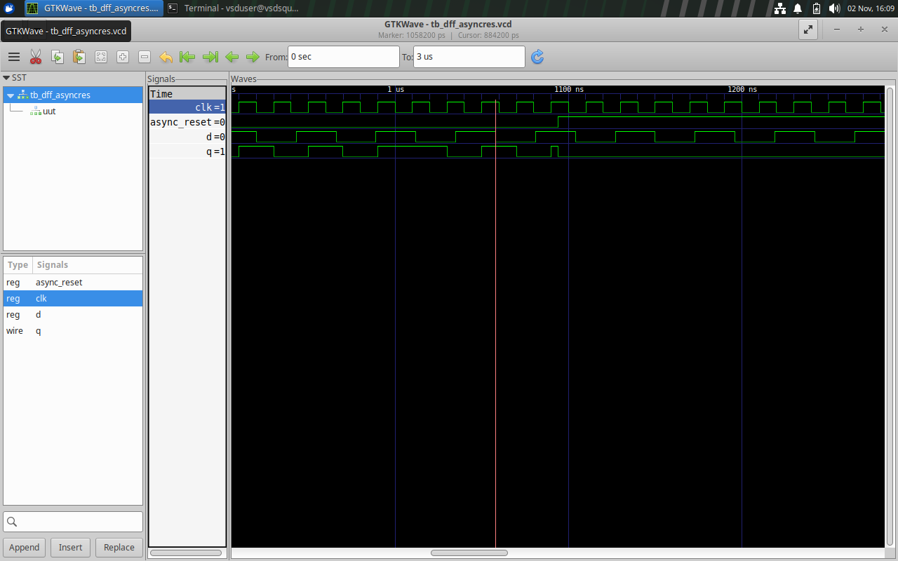
### Synthesized Graphical Representation

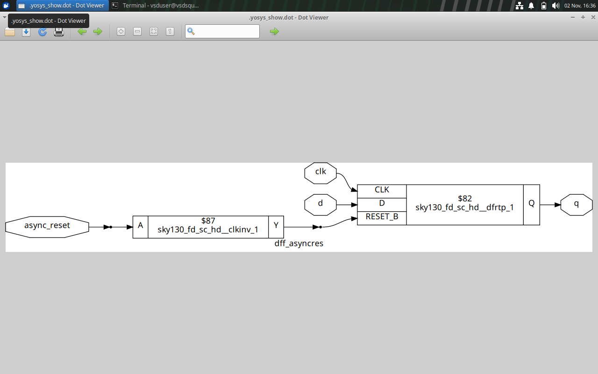
---

### D Flip-Flop with Asynchronous Set

### Verilog Code (`dff_async_set.v`)

```verilog
module dff_async_set ( input clk , input async_set , input d , output reg q );
always @ (posedge clk , posedge async_set)
begin
    if(async_set)
        q <= 1'b1;
    else
        q <= d;
end
endmodule
```

### Testbench Code (`tb_dff_async_set.v`)

```verilog
`timescale 1ns / 1ps
module tb_dff_async_set;
        // Inputs
        reg clk, async_set, d;
        // Outputs
        wire q;

        // Instantiate the Unit Under Test (UUT)
        dff_async_set uut (
                .clk(clk),
                .async_set(async_set),
                .d(d),
                .q(q)
        );

        initial begin
        $dumpfile("tb_dff_async_set.vcd");
        $dumpvars(0,tb_dff_async_set);
        // Initialize Inputs
        clk = 0;
        async_set = 1;
        d = 0;
        #3000 $finish;
        end

always #10 clk = ~clk;
always #23 d = ~d;
always #547 async_set=~async_set;
endmodule
```

### Simulation Waveform
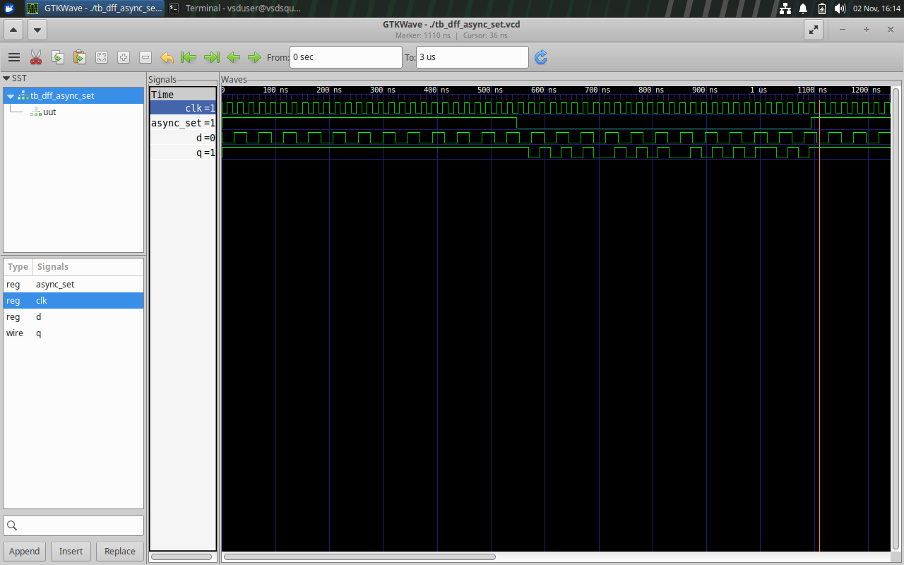


### Synthesized Graphical Representation

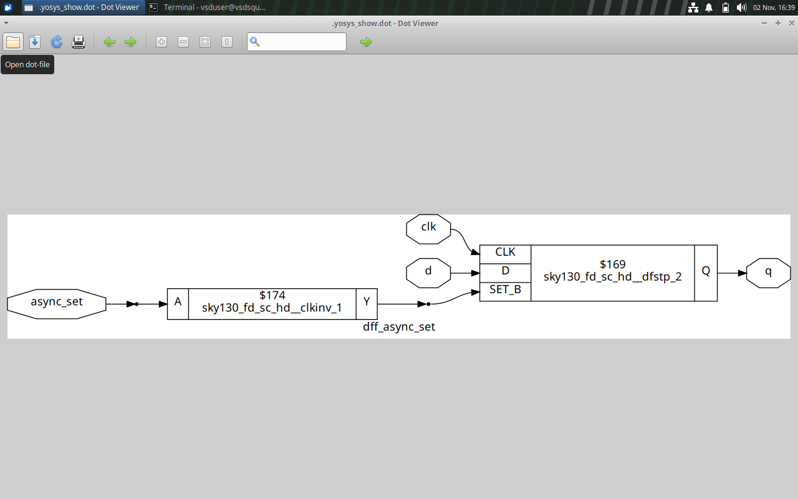

---

### D Flip-Flop with Synchronous Reset

### Verilog Code (`dff_syncres.v`)

```verilog
module dff_syncres ( input clk , input async_reset , input sync_reset , input d , output reg q );
always @ (posedge clk)
begin
    if (sync_reset)
        q <= 1'b0;
    else
        q <= d;
end
endmodule
```

### Testbench Code (`tb_dff_syncres.v`)

```verilog
`timescale 1ns / 1ps
module tb_dff_syncres;
        // Inputs
        reg clk, sync_reset, d;
        // Outputs
        wire q;

        // Instantiate the Unit Under Test (UUT)
        dff_syncres uut (
                .clk(clk),
                .sync_reset(sync_reset),
                .d(d),
                .q(q)
        );

        initial begin
        $dumpfile("tb_dff_syncres.vcd");
        $dumpvars(0,tb_dff_syncres);
        // Initialize Inputs
        clk = 0;
        sync_reset = 0;
        d = 0;
        #3000 $finish;
        end

always #10 clk = ~clk;
always #23 d = ~d;
always #113 sync_reset = ~sync_reset;
endmodule
```

### Simulation Waveform
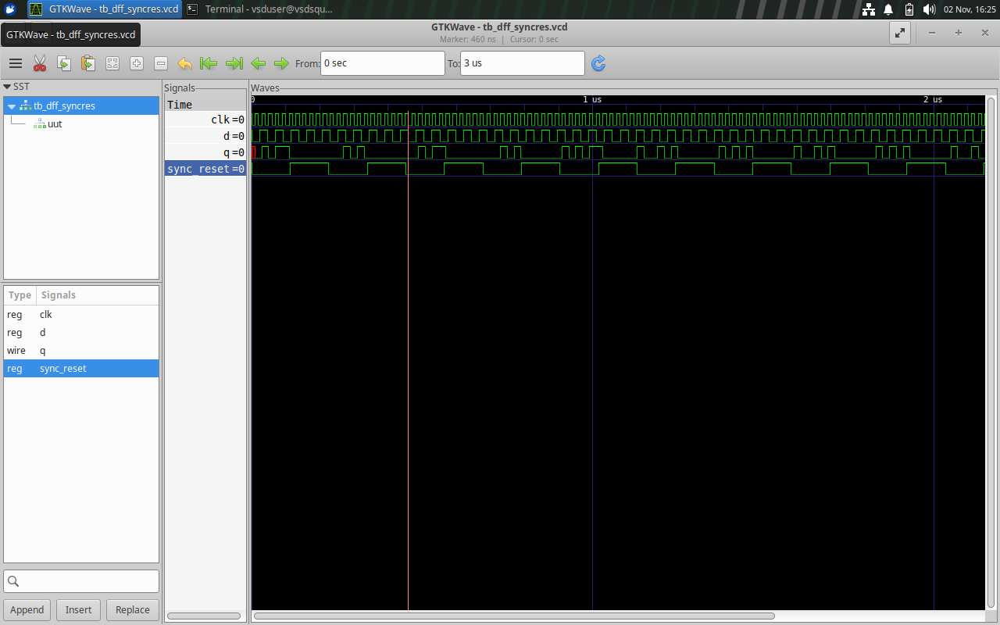


### Synthesized Graphical Representation

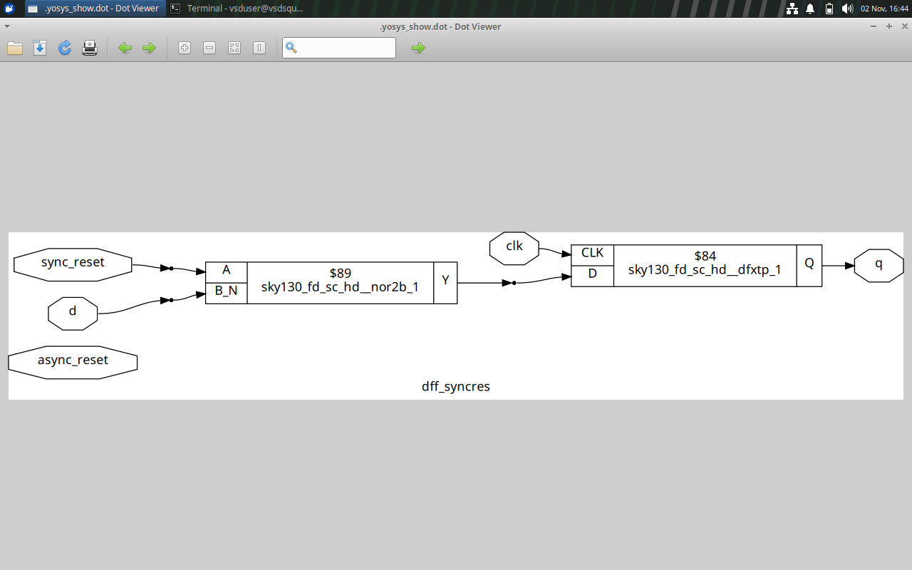

---
## 8. Arithmetic Operations Using Verilog

Arithmetic operations were also explored using simple Verilog modules.

### 8.1 Multiplication by 2

**File: `mult_2.v`**

```verilog
module mul2 (input [2:0] a, output [3:0] y);

    assign y = a * 2;

endmodule
```

This module multiplies a 3-bit input by 2 and produces a 4-bit output.
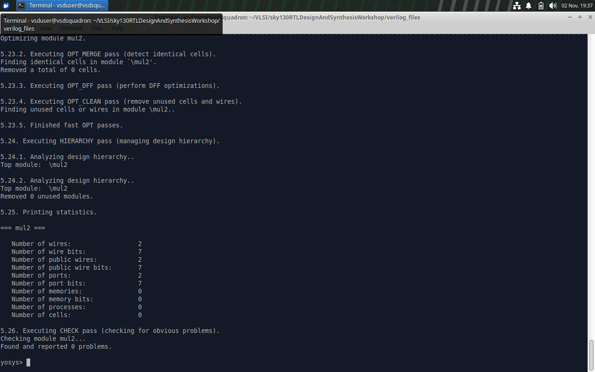
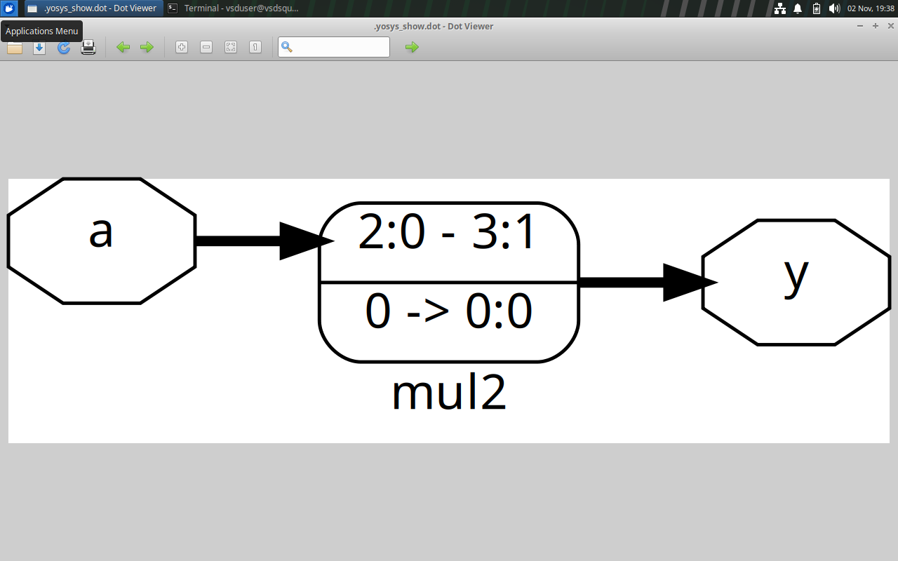
### 8.2 Multiplication by 9

**File: `mult_8.v`**

```verilog
module mult8 (input [2:0] a, output [5:0] y);

    assign y = a * 9;

endmodule
```

This module multiplies a 3-bit input by 9 and produces a 6-bit output.

### Synthesis

The modules were read and synthesized using Yosys.

```yosys
read_verilog mult_2.v
synth -top mul2
stat
check
```

For the second module:

```yosys
read_verilog mult_8.v
synth -top mult8
stat
check
```

The synthesis statistics were examined to understand how Yosys processes arithmetic expressions and optimizes the resulting logic.

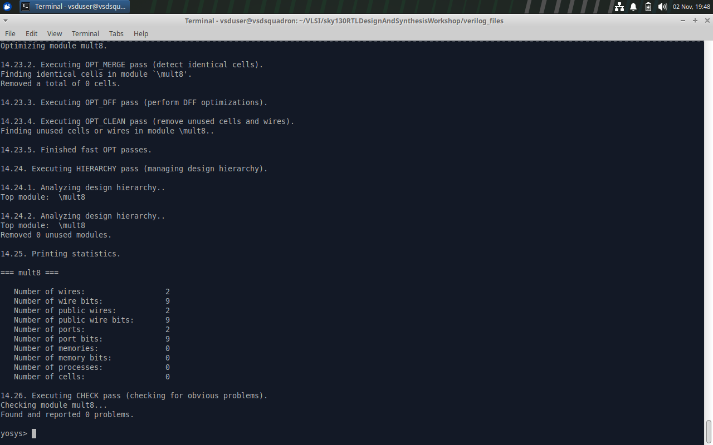

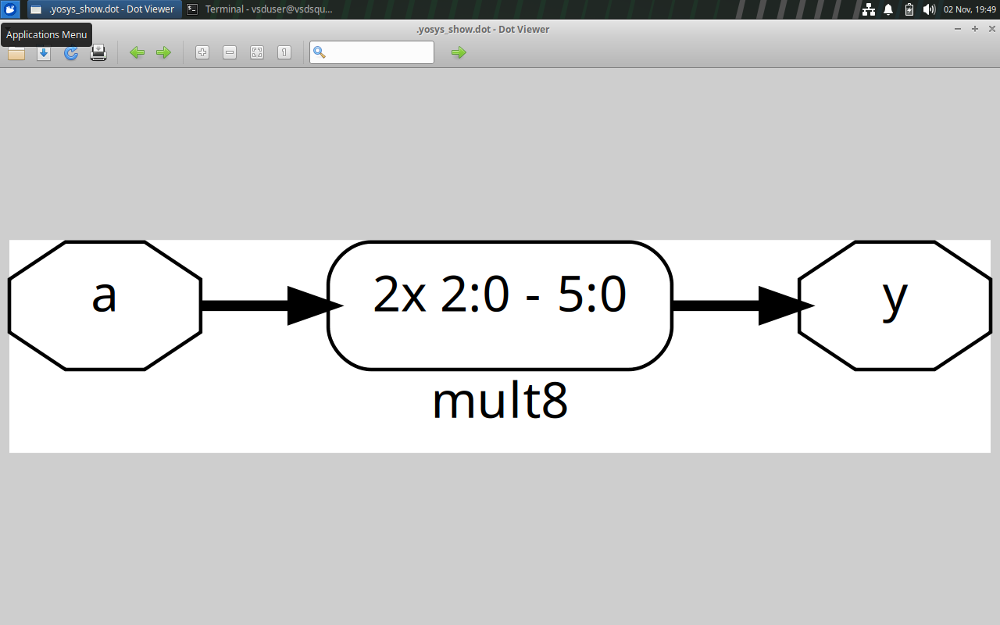

---
## 9. Key Observations

1. A multi-module Verilog design can be implemented using module instantiation.
2. Hierarchical synthesis preserves the structural organization of the design.
3. Flat synthesis removes the hierarchy and combines the logic into a single module.
4. Yosys performs RTL synthesis and generates gate-level representations.
5. Liberty files provide standard cell information for technology mapping.
6. SKY130 standard cells are used to represent the synthesized logic.
7. Arithmetic expressions can be optimized during synthesis.
8. A D Flip-Flop stores data at the active clock edge.
9. A synchronous reset takes effect only at the active clock edge.
10. GTKWave helps verify the functional behavior of sequential circuits.

---

## 10. Conclusion

Day 2 provided practical exposure to multi-module RTL design, hierarchical and flat synthesis, and technology mapping using the SKY130 standard cell library.

The session also covered arithmetic operations in Verilog and the design of a D Flip-Flop with synchronous reset.

Yosys was used to synthesize and analyze the RTL designs, while Icarus Verilog and GTKWave were used to simulate and verify sequential circuit behavior.

Overall, the exercises helped strengthen the understanding of RTL design, synthesis, standard cell mapping, and functional verification.

---

## 11. Tools and Technologies Used

| Tool / Technology | Purpose |
|---|---|
| Verilog | RTL design |
| Neovim | Verilog code editing |
| Yosys | RTL synthesis |
| SKY130 | Standard cell technology |
| Liberty File | Standard cell definitions |
| Icarus Verilog | Functional simulation |
| GTKWave | Waveform visualization |
| Linux | Development environment |

---

## 12. Repository Structure

```text
Day_02/
│
├── verilog_files/
│   ├── multiple_modules.v
│   ├── mult_2.v
│   ├── mult_8.v
│   ├── dff_syncres.v
│   └── tb_dff_syncres.v
│
├── images/
│   ├── multiple_modules_code.png
│   ├── multiple_modules_hier.png
│   ├── hierarchical_synthesis.png
│   ├── multiple_modules_flat.png
│   ├── flattened_netlist.png
│   ├── technology_mapped_netlist.png
│   ├── mul2_synthesis.png
│   ├── mult8_synthesis.png
│   └── dff_syncres_waveform.png
│
└── README.md
```

