# Day 3 – Combinational and Sequential Logic Optimization

---

## 1. Combinational Logic Optimization

### Theory

Combinational logic optimization is the process of simplifying a logic circuit to obtain an optimized design.

The techniques discussed include:

- **Constant Propagation:** Replacing constant values in logic expressions to simplify the circuit.
- **Boolean Expression Optimization:** Simplifying Boolean expressions using techniques such as K-map and Quine-McCluskey.

### Experiment 1: Opt_check

#### Verilog Code (`opt_check.v`)

```verilog
module opt_check (input a , input b , output y);
    assign y = a?b:0;
endmodule
```

#### Testbench (`tb_opt_check.v`)

```verilog
`timescale 1ns / 1ps
module tb_opt_check;
    // Inputs
    reg a,b;
    // Outputs
    wire y;

    // Instantiate the Unit Under Test (UUT)
    opt_check uut (
        .a(a),
        .b(b),
        .y(y)
    );

    initial begin
        $dumpfile("tb_opt_check.vcd");
        $dumpvars(0,tb_opt_check);
        // Initialize Inputs
        a = 0;
        b = 0;
        #300 $finish;
    end

    always #10 a = ~a;
    always #55 b = ~b;
endmodule
```

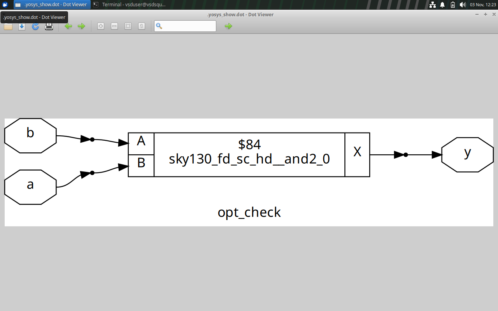

### Experiment 2: opt_check2

#### Verilog Code (`opt_check2.v`)

```verilog
module opt_check2 (input a , input b , output y);
    assign y = a?1:b;
endmodule
```

#### Testbench (`tb_opt_check2.v`)

```verilog
`timescale 1ns / 1ps
module tb_opt_check2;
    // Inputs
    reg a,b;
    // Outputs
    wire y;

    // Instantiate the Unit Under Test (UUT)
    opt_check2 uut (
        .a(a),
        .b(b),
        .y(y)
    );

    initial begin
        $dumpfile("tb_opt_check2.vcd");
        $dumpvars(0,tb_opt_check2);
        // Initialize Inputs
        a = 0;
        b = 0;
        #300 $finish;
    end

    always #10 a = ~a;
    always #55 b = ~b;
endmodule
```
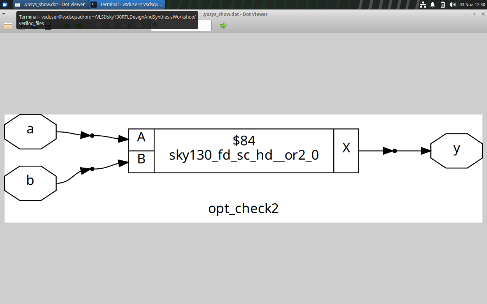

### Experiment 3: opt_check3

#### Verilog Code (`opt_check3.v`)

```verilog
module opt_check3 (input a , input b , input c , output y);
    assign y = a?(c?b:0):0;
endmodule
```

#### Testbench (`tb_opt_check3.v`)

```verilog
`timescale 1ns / 1ps
module tb_opt_check3;
    // Inputs
    reg a,b,c;
    // Outputs
    wire y;

    // Instantiate the Unit Under Test (UUT)
    opt_check3 uut (
        .a(a),
        .b(b),
        .c(c),
        .y(y)
    );

    initial begin
        $dumpfile("tb_opt_check3.vcd");
        $dumpvars(0,tb_opt_check3);
        // Initialize Inputs
        a = 0;
        b = 0;
        c = 0;
        #300 $finish;
    end

    always #10 a = ~a;
    always #55 b = ~b;
    always #75 c = ~c;
endmodule
```
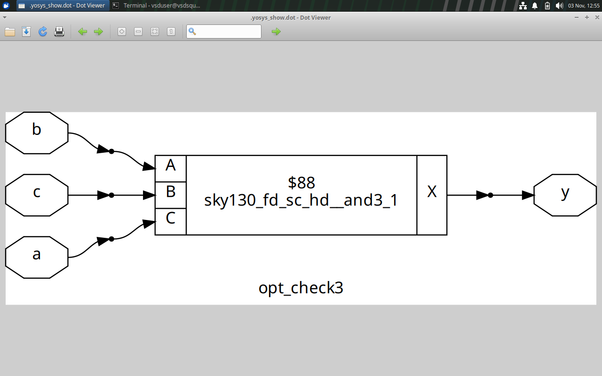

### Experiment 4: opt_check4

#### Verilog Code (`opt_check4.v`)

```verilog
module opt_check4 (input a , input b , input c , output y);
    assign y = a?(b?(a & c):c):(!c);
endmodule
```
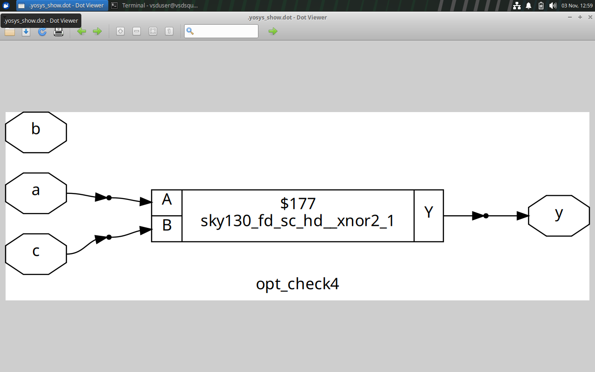
---

## 2. Multiple Module Optimization

### Verilog Code (`multiple_module_opt.v`)

```verilog
module sub_module1(input a , input b , output y);
    assign y = a & b;
endmodule

module sub_module2(input a , input b , output y);
    assign y = a^b;
endmodule

module multiple_module_opt(input a , input b , input c , input d , output y);
    wire n1,n2,n3;

    sub_module1 U1 (.a(a) , .b(1'b1) , .y(n1));
    sub_module2 U2 (.a(n1) , .b(1'b0) , .y(n2));
    sub_module2 U3 (.a(b) , .b(d) , .y(n3));

    assign y = c | (b & n1);

endmodule
```
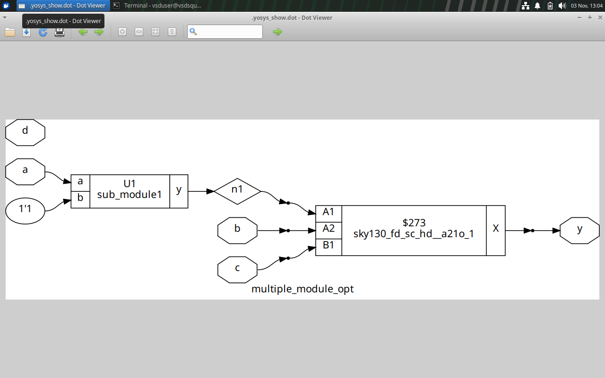
---

## 3. Sequential Logic Optimization

### Theory

Sequential logic optimization is used to simplify sequential circuits and improve their implementation.

The techniques discussed include:

1. Basic sequential constant propagation.
2. Advanced 1-state optimization.
3. Retiming.
4. Sequential logic cloning.

### Sequential Constant Propagation

In sequential constant propagation, if a signal is assigned a constant value, the constant can be propagated through the sequential logic.

The video sessions also discuss optimization of unused states, retiming and sequential logic cloning.

---

## 4. Counter Optimization

### Experiment 1: counter_opt

#### Verilog Code (`counter_opt.v`)

```verilog
module counter_opt (input clk , input reset , output q);
reg [2:0] count;
assign q = count[0];

always @(posedge clk , posedge reset)
begin
    if(reset)
        count <= 3'b000;
    else
        count <= count + 1;
end

endmodule
```
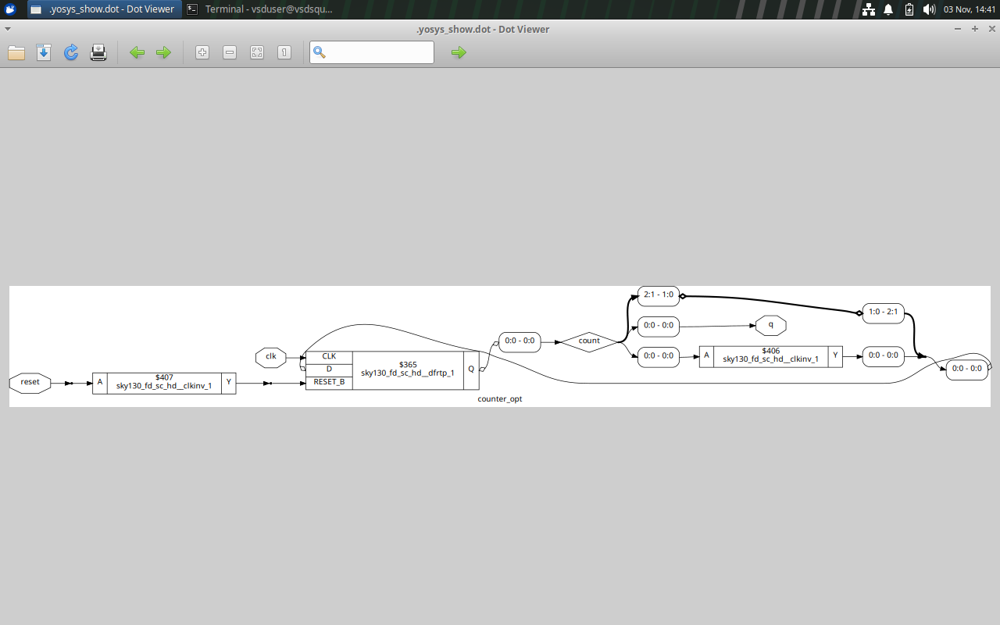

### Experiment 2: counter_opt2

#### Verilog Code (`counter_opt2.v`)

```verilog
module counter_opt (input clk , input reset , output q);
reg [2:0] count;
assign q = (count[2:0]== 3'b100);

always @(posedge clk , posedge reset)
begin
    if(reset)
        count <= 3'b000;
    else
        count <= count + 1;
end

endmodule
```
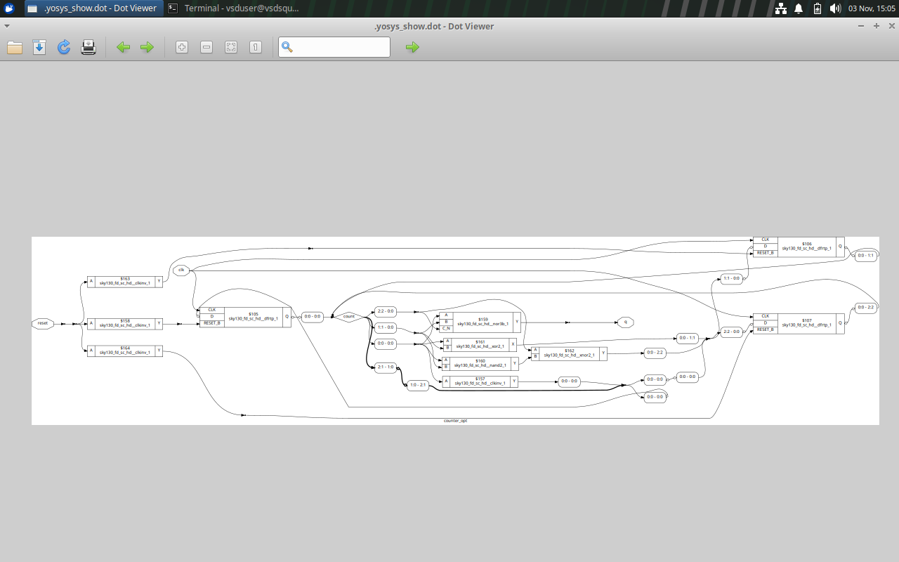
---

## 5. D Flip-Flop Constant Optimization

### Experiment 1: dff_const1

```verilog
module dff_const1(input clk, input reset, output reg q);
always @(posedge clk, posedge reset)
begin
    if(reset)
        q <= 1'b0;
    else
        q <= 1'b1;
end
endmodule
```
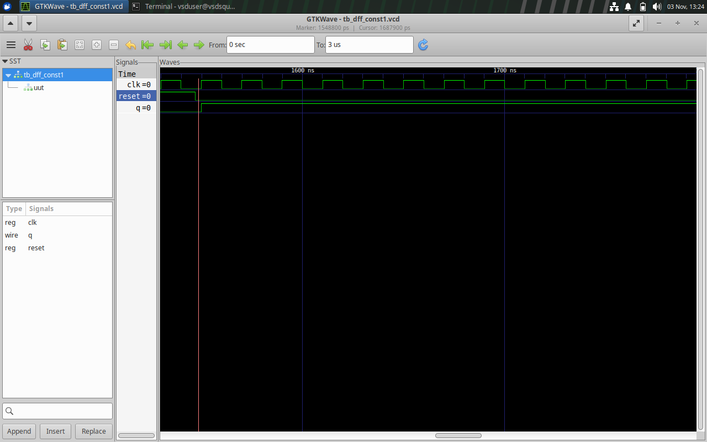
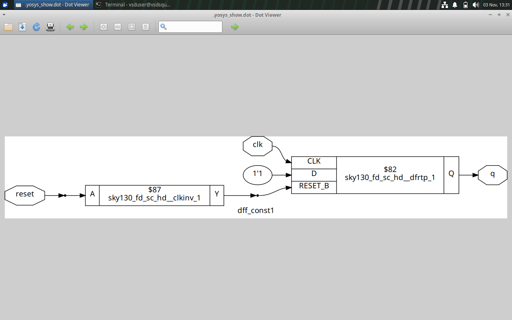
### Experiment 2: dff_const2

```verilog
module dff_const2(input clk, input reset, output reg q);
always @(posedge clk, posedge reset)
begin
    if(reset)
        q <= 1'b1;
    else
        q <= 1'b1;
end
endmodule
```
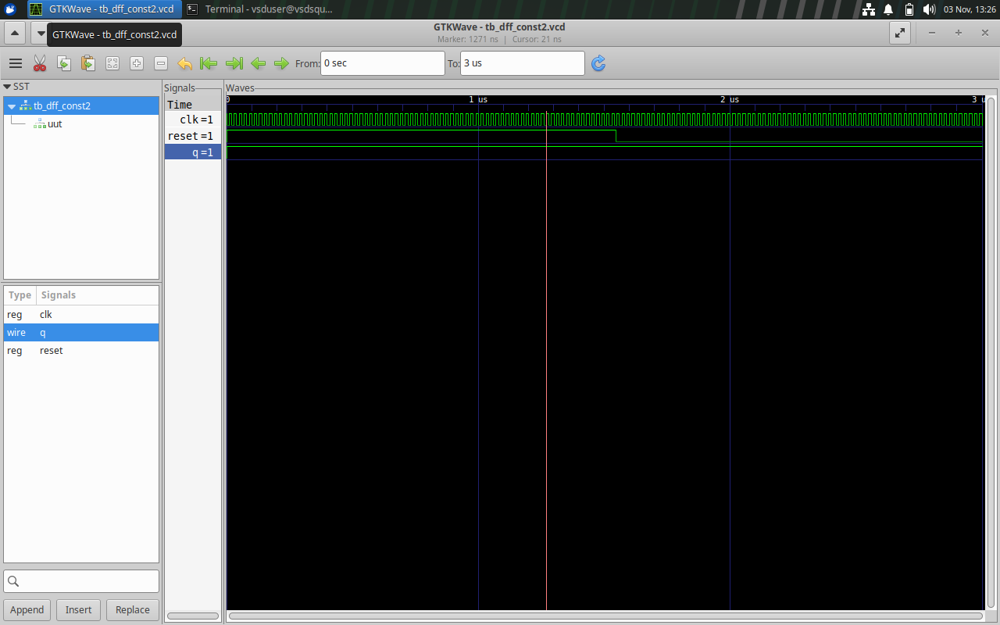
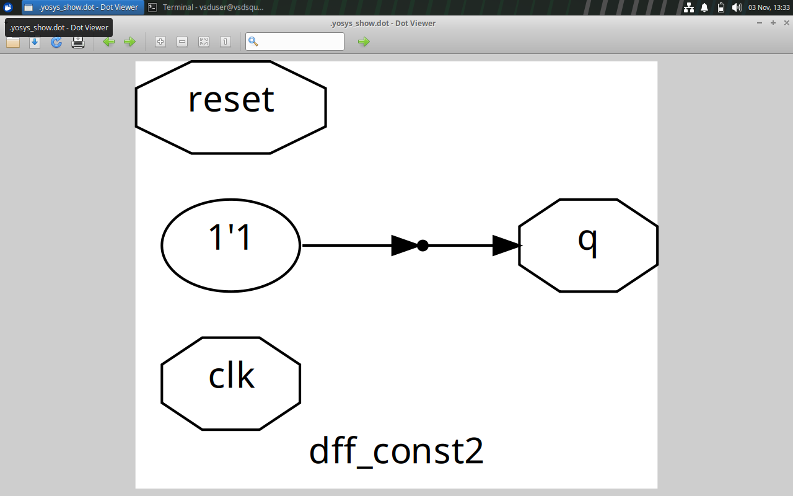
### Experiment 3: dff_const3

```verilog
module dff_const3(input clk, input reset, output reg q);
reg q1;

always @(posedge clk, posedge reset)
begin
    if(reset)
    begin
        q <= 1'b1;
        q1 <= 1'b0;
    end
    else
    begin
        q1 <= 1'b1;
        q <= q1;
    end
end
endmodule
```
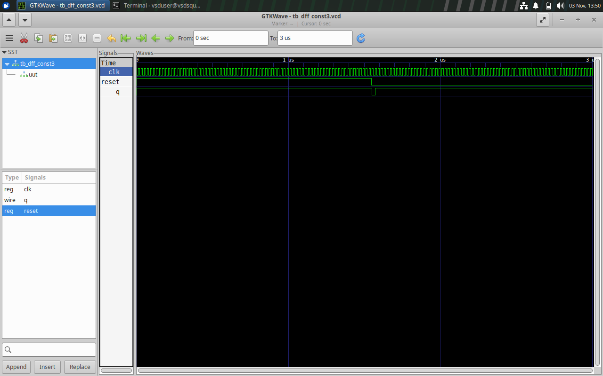
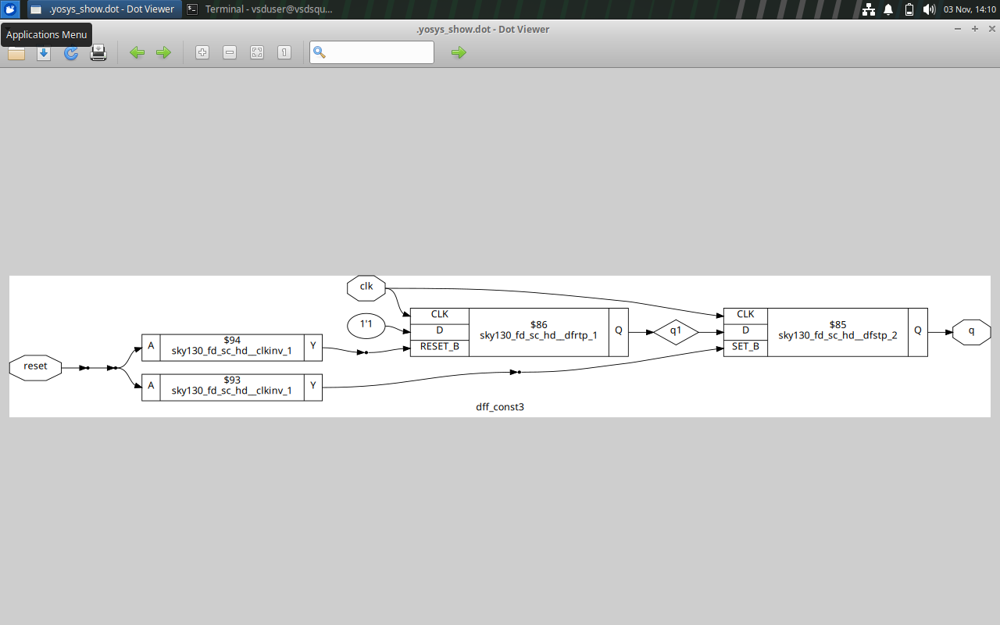
### Experiment 4: dff_const4

```verilog
module dff_const4(input clk, input reset, output reg q);
reg q1;

always @(posedge clk, posedge reset)
begin
    if(reset)
    begin
        q <= 1'b1;
        q1 <= 1'b1;
    end
    else
    begin
        q1 <= 1'b1;
        q <= q1;
    end
end
endmodule
```
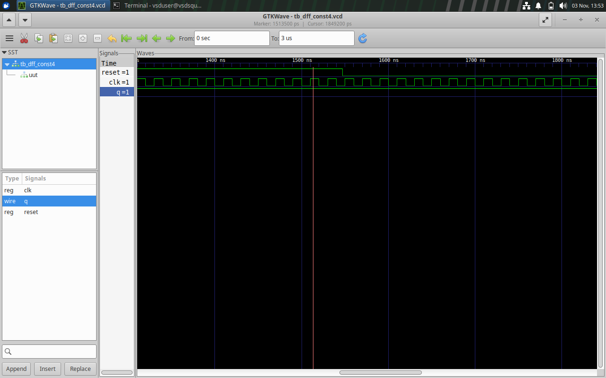
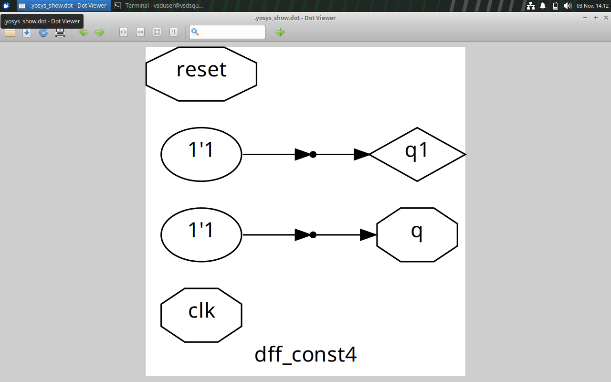
### Experiment 5: dff_const5

```verilog
module dff_const5(input clk, input reset, output reg q);
reg q1;

always @(posedge clk, posedge reset)
begin
    if(reset)
    begin
        q <= 1'b0;
        q1 <= 1'b0;
    end
    else
    begin
        q1 <= 1'b1;
        q <= q1;
    end
end
endmodule
```
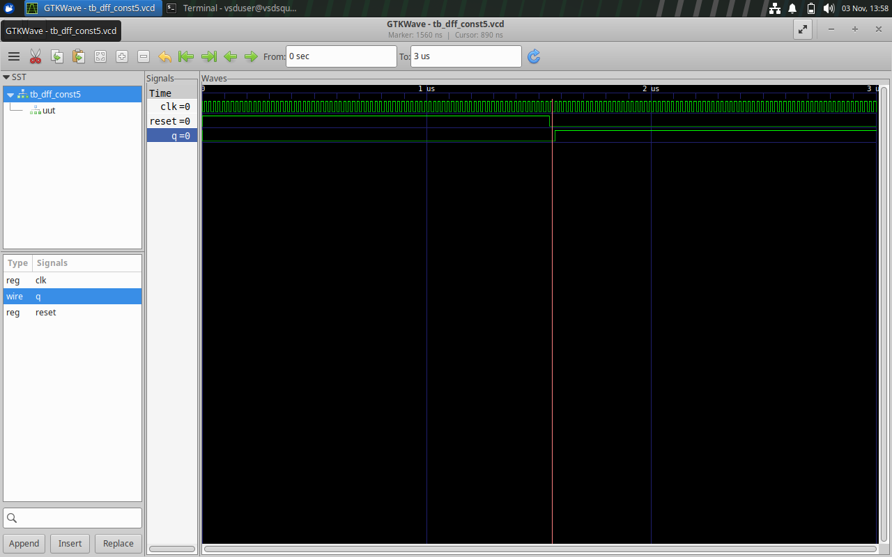

---

## 6. Key Learnings

- Understood combinational logic optimization.
- Studied constant propagation and Boolean expression optimization.
- Practiced conditional operators in Verilog.
- Implemented multiple-module designs.
- Studied sequential logic optimization techniques.
- Implemented counter optimization.
- Explored constant propagation in D flip-flop designs.

---

## 7. Tools Used

- Verilog HDL
- Neovim
- Linux Terminal
- Yosys
- Icarus Verilog
- GTKWave

---

## Conclusion

Day 3 focused on combinational and sequential logic optimization using Verilog HDL. Different optimization examples were implemented, including conditional logic, multiple-module designs, counters and D flip-flops. The exercises helped understand how constant propagation and other optimization techniques simplify digital logic designs.
