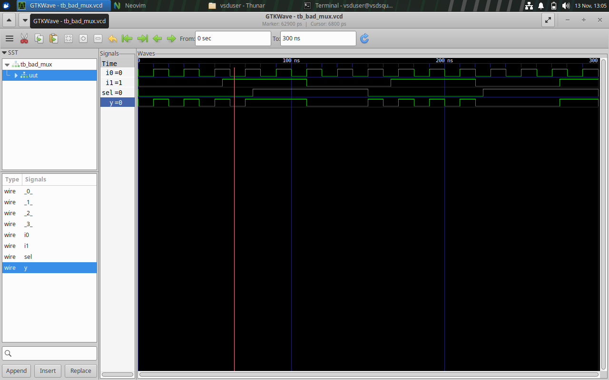
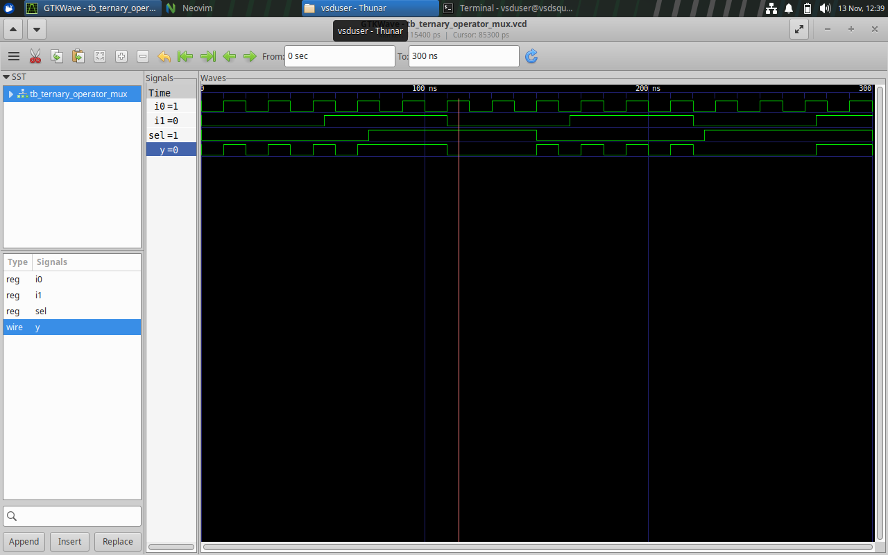
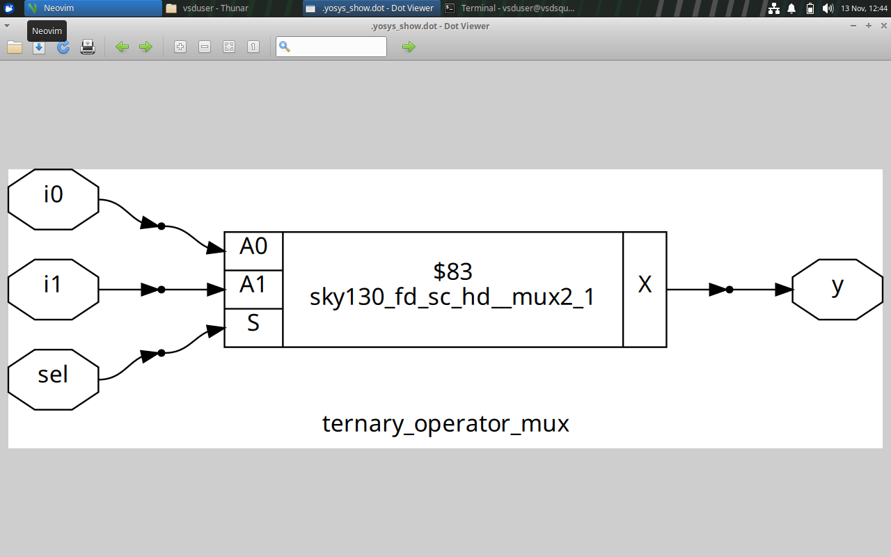
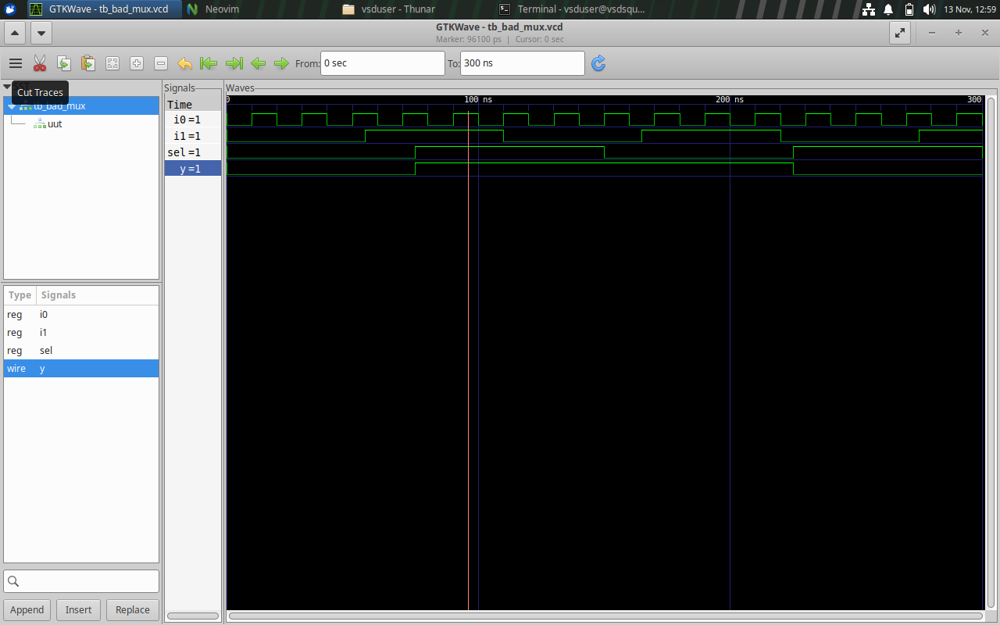
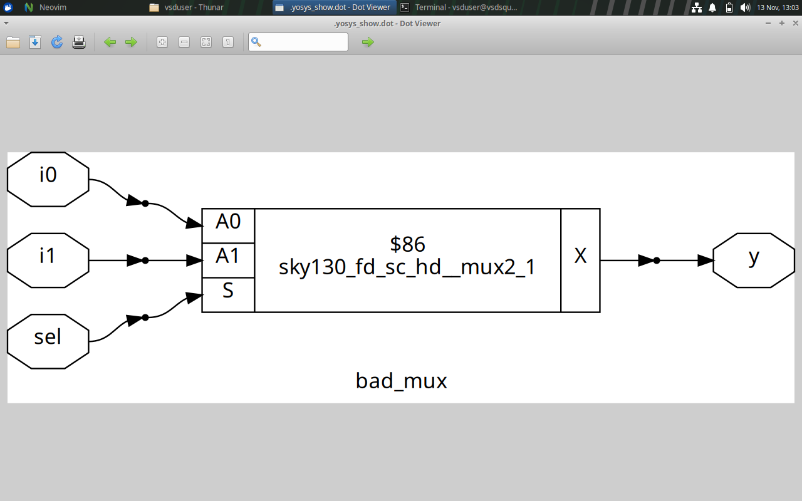
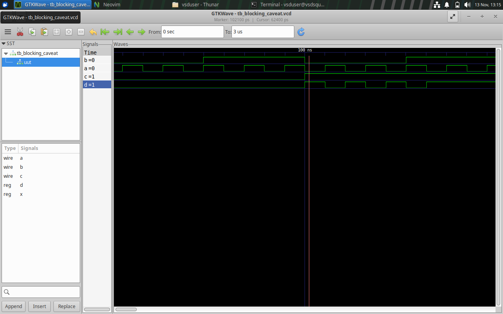
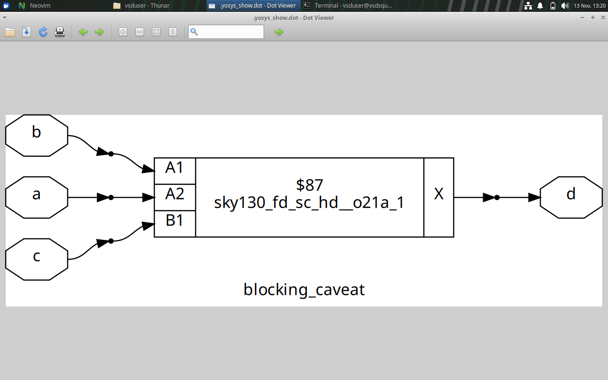
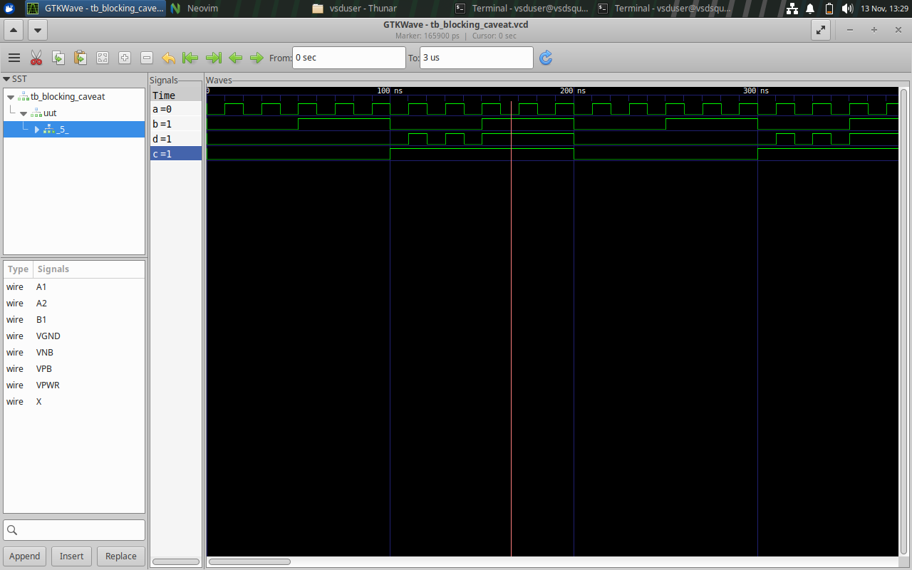

# Day 4 – Gate Level Simulation (GLS), Blocking and Non-Blocking Assignments

## Overview

Day 4 of the VSD Women in VLSI Training Program focused on Gate Level Simulation (GLS), synthesis-simulation mismatch, Verilog coding styles, and the differences between blocking and non-blocking assignments.

## 1. Gate Level Simulation (GLS)

Gate Level Simulation is performed by running the testbench with the synthesized netlist as the Design Under Test (DUT).

- The netlist is logically equivalent to the RTL code.
- The same testbench can be used for RTL simulation and gate-level simulation.
- GLS verifies the logical correctness of the design after synthesis.
- It helps ensure that the timing requirements of the design are met.
- For timing verification, GLS needs to be performed with delay annotation.

### GLS Flow

1. RTL design is synthesized to generate a gate-level netlist.
2. The gate-level netlist and testbench are given to Icarus Verilog.
3. Simulation generates a VCD file.
4. The VCD file is viewed using GTKWave.



## 2. Gate-Level Verilog Models

After synthesis, the design is represented using different standard-cell gates.

These gates are represented using Gate-Level Verilog Models. They can be of two types:

### Functional Models

- Describe only the functionality or behaviour of the gates.
- Do not include timing constraints.

### Timing-Aware Models

- Describe the functionality of the gates.
- Also include the timing constraints of the gates.

## 3. Synthesis-Simulation Mismatch

Synthesis-simulation mismatch occurs when the behaviour observed during RTL simulation differs from the behaviour of the synthesized design.

The topics covered include:

- Missing sensitivity list.
- Blocking versus non-blocking assignments.
- Non-standard Verilog coding styles.

### Missing Sensitivity List

A sensitivity list specifies the signals whose changes trigger the execution of an `always` block.

If a signal used inside the block is missing from the sensitivity list, the simulation may not update the output when that signal changes.

Using `always @(*)` automatically includes all signals read by the combinational logic in the sensitivity list.

## 4. Blocking and Non-Blocking Assignments

### Blocking Assignment

- Uses a single equal sign (`=`).
- Statements execute in the order in which they are written.
- The first statement is evaluated before the next statement.
- Commonly used for combinational logic.

### Non-Blocking Assignment

- Uses the operator `<=`.
- Right-hand-side expressions are evaluated when the always block is entered.
- Left-hand-side updates are scheduled and take effect later in the simulation time step.
- Useful for describing sequential circuits.

**Important:** Always use non-blocking assignments when writing sequential circuits.

## 5. Ternary Operator MUX

A 2:1 multiplexer can be described using the ternary operator.

### Verilog Code

```verilog
module ternary_operator_mux (
    input i0,
    input i1,
    input sel,
    output y
);

assign y = sel ? i1 : i0;

endmodule
```

### Working

- When `sel = 0`, output `y = i0`.
- When `sel = 1`, output `y = i1`.

### RTL Code


### Simulation Waveform



### Gate-Level Synthesis



### Gate-Level Simulation


## 6. Bad MUX Coding Style

The following code uses an incomplete sensitivity list.

### Verilog Code

```verilog
module bad_mux (
    input i0,
    input i1,
    input sel,
    output reg y
);

always @(sel)
begin
    if (sel)
        y <= i1;
    else
        y <= i0;
end

endmodule
```

### Observation

The sensitivity list contains only `sel`. Changes in `i0` or `i1` do not trigger the always block.

Therefore, the output may not update correctly when the input data changes.

### Simulation Waveform



### Gate-Level Synthesis



### Gate-Level Simulation


## 7. Correct MUX Coding Style

The correct way to describe combinational logic is to use `always @(*)`.

### Verilog Code

```verilog
module good_mux (
    input i0,
    input i1,
    input sel,
    output reg y
);

always @(*)
begin
    if (sel)
        y <= i1;
    else
        y <= i0;
end

endmodule
```

### Observation

- `always @(*)` automatically includes all signals used in the combinational logic.
- The output responds to changes in the inputs.
- This avoids the incomplete sensitivity-list problem.

### RTL Code


## 8. Caveats with Blocking Assignments

Consider the following Verilog code:

```verilog
module blocking_caveat (
    input a,
    input b,
    input c,
    output reg d
);

reg x;

always @(*)
begin
    d = x & c;
    x = a | b;
end

endmodule
```

### Explanation

- Blocking assignments execute statements sequentially.
- The statement `d = x & c` is evaluated first.
- The next statement updates `x = a | b`.
- Therefore, `d` uses the previous value of `x` in that execution.
- This can result in unexpected behaviour and synthesis-simulation mismatch.

### RTL Code


### Simulation Waveform



### Gate-Level Synthesis



### Gate-Level Simulation



## 9. Key Learnings

- Understood the purpose of Gate Level Simulation.
- Learned how to verify the synthesized netlist using the same testbench.
- Understood the difference between functional and timing-aware gate-level models.
- Learned how an incomplete sensitivity list can cause simulation mismatch.
- Understood the difference between blocking (`=`) and non-blocking (`<=`) assignments.
- Learned why non-blocking assignments should be used for sequential circuits.
- Understood how coding styles affect RTL simulation and synthesized behaviour.
- Practised MUX implementation using the ternary operator and `always` blocks.

## 10. Tools Used

- Verilog
- Icarus Verilog
- Yosys
- GTKWave
- SKY130 Standard Cell Library

---

## Conclusion

Day 4 provided practical understanding of Gate Level Simulation, synthesis-simulation mismatch, and Verilog coding practices. The exercises demonstrated the importance of correct sensitivity lists and assignment types for achieving reliable RTL and gate-level simulation results.
