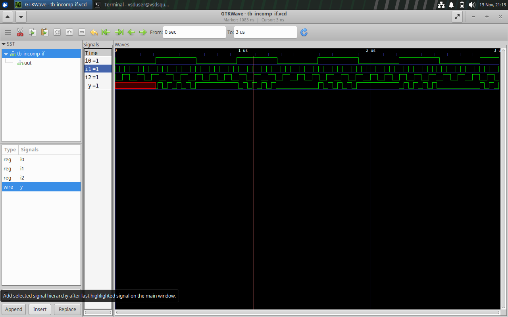
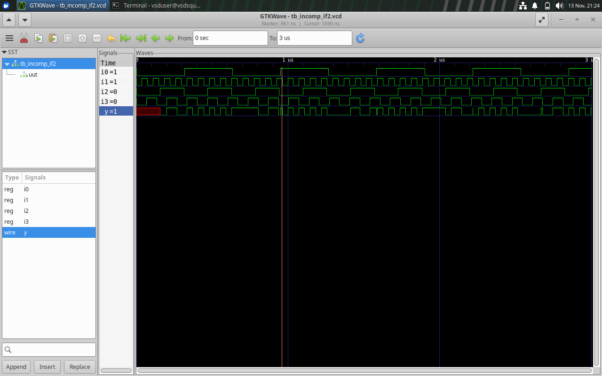
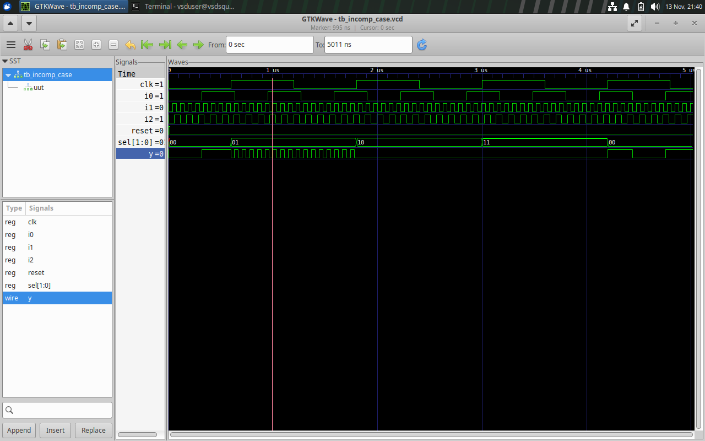
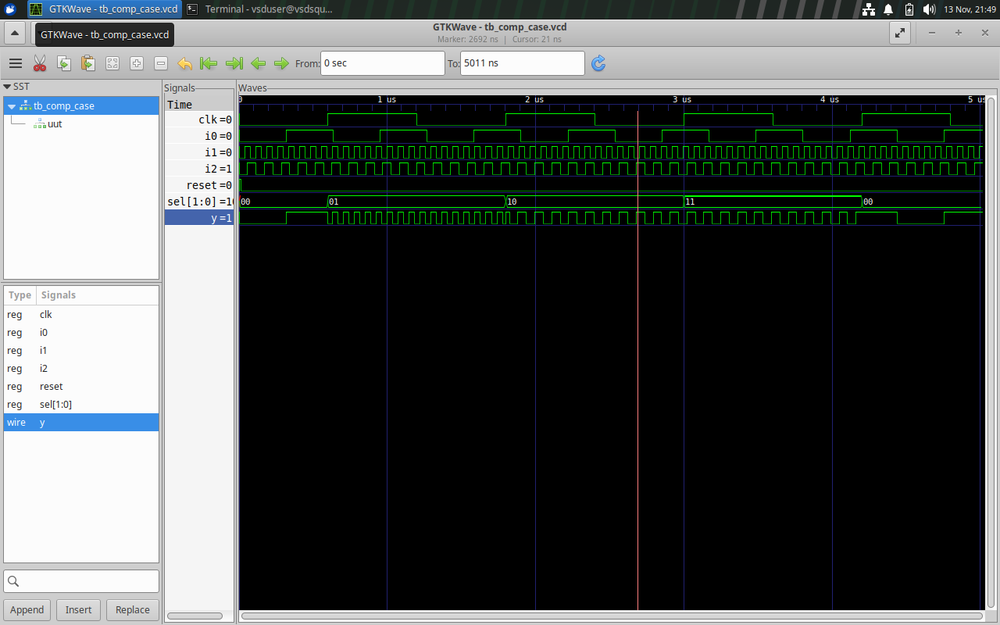
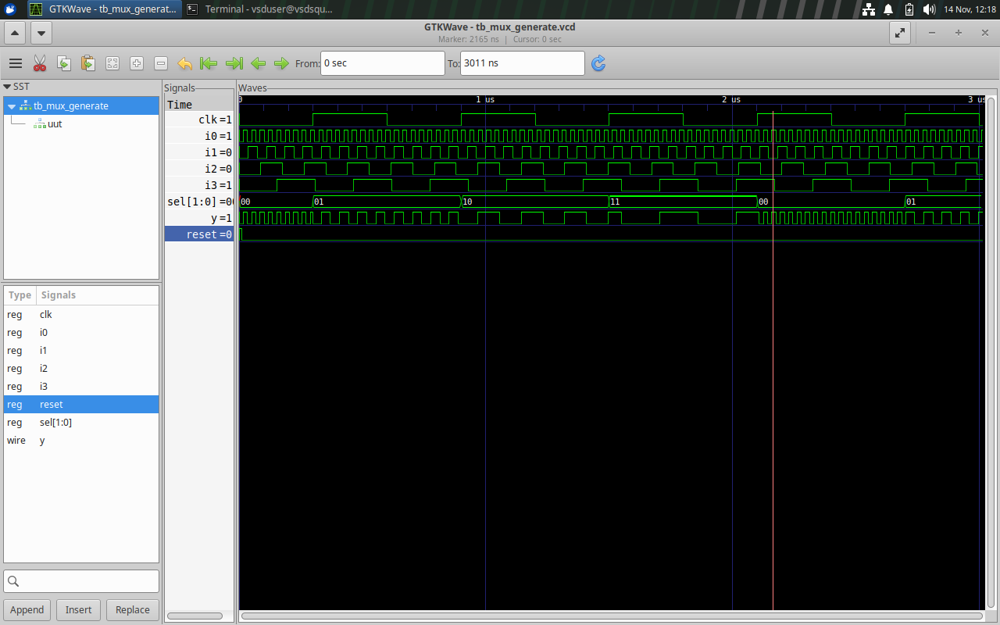
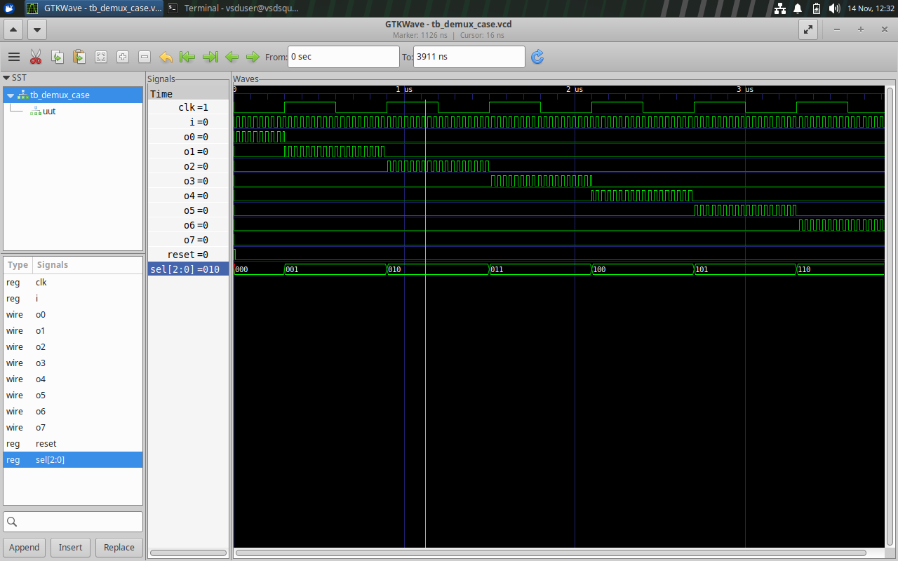
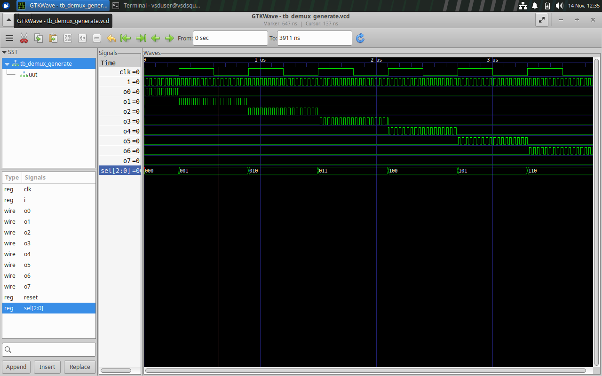
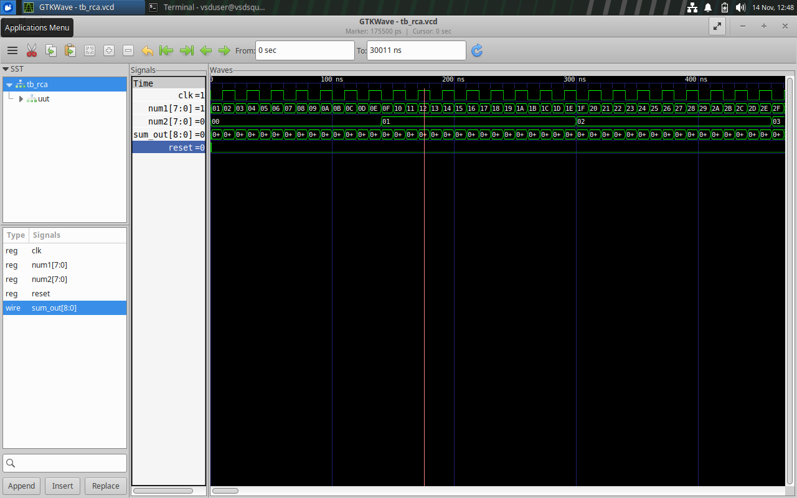

# Day 5 – Optimization in Synthesis


## 1. If-Else Statements

The `if-else` construct is used to create priority logic.

Both `if` and `case` statements are generally used inside an `always` block. Variables assigned inside these procedural blocks must be declared as `reg` in Verilog.

### Syntax

```verilog
always @(*) begin
    if (condition)
        // statements
    else
        // statements
end
```

### Incomplete If Statement

An incomplete `if` statement occurs when an assignment is not provided for every possible condition.

For example:

```verilog
module incomp_if (
    input i0,
    input i1,
    input i2,
    output reg y
);

always @(*) begin
    if (i0)
        y = i1;
end

endmodule
```

When `i0` is false, no new value is assigned to `y`. The previous value must be retained, which can result in an inferred latch.

**Important:** Incomplete conditional assignments should be avoided in combinational logic when latch-free hardware is intended.

### Complete If-Else Assignment

Providing an `else` branch ensures that the output is assigned for both possible conditions.

```verilog
module comp_if (
    input i0,
    input i1,
    output reg y
);

always @(*) begin
    if (i0)
        y = i1;
    else
        y = 1'b0;
end

endmodule
```

### Multiple If-Else Conditions

```verilog
module incomp_if2 (
    input i0,
    input i1,
    input i2,
    input i3,
    output reg y
);

always @(*) begin
    if (i0)
        y <= i1;
    else if (i2)
        y <= i3;
end

endmodule
```

This example is incomplete because there is no final `else` assignment. If neither condition is true, the previous value of `y` is retained.

### Simulation Results

The following waveforms demonstrate the behaviour of the incomplete and conditional `if` implementations.








## 2. Case Statements

A `case` statement is used to select one among multiple alternatives based on the value of a selector.

### Syntax

```verilog
always @(*) begin
    case (sel)
        2'b00: y = i0;
        2'b01: y = i1;
        2'b10: y = i2;
        2'b11: y = i3;
        default: y = 1'b0;
    endcase
end
```

### Complete Case Statement

A complete case statement assigns an output for every possible selector value.

```verilog
module comp_case (
    input i0,
    input i1,
    input i2,
    input [1:0] sel,
    output reg y
);

always @(*) begin
    case(sel)
        2'b00: y = i0;
        2'b01: y = i1;
        default: y = i2;
    endcase
end

endmodule
```

### Incomplete Case Statement

```verilog
module incomp_case (
    input i0,
    input i1,
    input i2,
    input [1:0] sel,
    output reg y
);

always @(*) begin
    case(sel)
        2'b00: y = i0;
        2'b01: y = i1;
    endcase
end

endmodule
```

The selector values `2'b10` and `2'b11` are not explicitly handled. Since the output is not assigned for those conditions, an inferred latch can be created.

To avoid this, use a `default` assignment.

### Partial Assignment in Case

```verilog
module partial_case_assign (
    input i0,
    input i1,
    input i2,
    input [1:0] sel,
    output reg y,
    output reg x
);

always @(*) begin
    case(sel)
        2'b00: begin
            y = i0;
            x = i2;
        end

        2'b01: y = i1;

        default: begin
            x = i1;
            y = i2;
        end
    endcase
end

endmodule
```

In the `2'b01` condition, only `y` is assigned and `x` is not assigned. This can cause an inferred latch on `x`.

### Bad Case Example

The following example illustrates the importance of avoiding overlapping case conditions.

```verilog
module bad_case (
    input i0,
    input i1,
    input i2,
    input i3,
    input [1:0] sel,
    output reg y
);

always @(*) begin
    case(sel)
        2'b00: y = i0;
        2'b01: y = i1;
        2'b10: y = i2;
        2'b1?: y = i3;
    endcase
end

endmodule
```

Overlapping or ambiguous case conditions should be avoided because they can cause unintended selection behaviour.

### Simulation Results




## 3. Looping Constructs in Verilog

Two looping constructs were discussed.

### 3.1 For Loop

A `for` loop inside an `always` block is used for evaluating expressions and describing combinational logic.

It is useful when implementing wide multiplexers and demultiplexers.

### 3.2 For Loop with Generate

A `for` loop followed by a `generate` construct is used to instantiate or replicate hardware.

It is written outside procedural `always` blocks.

## 4. Multiplexer Using Generate Loop

A multiplexer selects one input from multiple input lines based on the select signal.

The following example implements a 4:1 multiplexer using a `for` loop.

```verilog
module mux_generate (
    input i0,
    input i1,
    input i2,
    input i3,
    input [1:0] sel,
    output reg y
);

wire [3:0] i_int;
assign i_int = {i3, i2, i1, i0};

integer k;

always @(*) begin
    for(k = 0; k < 4; k = k + 1) begin
        if(k == sel)
            y = i_int[k];
    end
end

endmodule
```

The input vector is formed by combining the four inputs. The loop checks the select value and assigns the corresponding input to the output.



## 5. Demultiplexer Using Case Statement

A demultiplexer routes a single input to one of several output lines depending on the select input.

The following example implements an 1:8 demultiplexer using a `case` statement.

```verilog
module demux_case (
    output o0,
    output o1,
    output o2,
    output o3,
    output o4,
    output o5,
    output o6,
    output o7,
    input [2:0] sel,
    input i
);

reg [7:0] y_int;
assign {o7,o6,o5,o4,o3,o2,o1,o0} = y_int;

always @(*) begin
    y_int = 8'b0;

    case(sel)
        3'b000: y_int[0] = i;
        3'b001: y_int[1] = i;
        3'b010: y_int[2] = i;
        3'b011: y_int[3] = i;
        3'b100: y_int[4] = i;
        3'b101: y_int[5] = i;
        3'b110: y_int[6] = i;
        3'b111: y_int[7] = i;
    endcase
end

endmodule
```

The internal vector is initialized to zero before the case statement. The selected output receives the input value, while the remaining outputs stay at zero.



## 6. Demultiplexer Using For Loop

The same 1:8 demultiplexer can also be implemented using a `for` loop.

```verilog
module demux_generate (
    output o0,
    output o1,
    output o2,
    output o3,
    output o4,
    output o5,
    output o6,
    output o7,
    input [2:0] sel,
    input i
);

reg [7:0] y_int;
assign {o7,o6,o5,o4,o3,o2,o1,o0} = y_int;

integer k;

always @(*) begin
    y_int = 8'b0;

    for(k = 0; k < 8; k = k + 1) begin
        if(k == sel)
            y_int[k] = i;
    end
end

endmodule
```

The loop iterates through all eight output positions and activates the output selected by `sel`.



## 7. Incomplete and Complete Case Simulation

Different case implementations were simulated to understand the effect of incomplete assignments and the importance of default conditions.

The testbenches applied input combinations and generated VCD files for waveform analysis.

### Testbench and Simulation Screenshots

.png)

.png)

.png)

.png)

.png)

## 8. Ripple Carry Adder

A ripple-carry adder is constructed by connecting multiple full adders in series.

The carry output of one full adder is connected to the carry input of the next full adder.

### Full Adder Module

```verilog
module fa (
    input a,
    input b,
    input c,
    output co,
    output sum
);

assign {co, sum} = a + b + c;

endmodule
```

### Ripple Carry Adder Module

The following design uses full-adder instances to construct an 8-bit ripple-carry adder.

```verilog
module rca (
    input [7:0] num1,
    input [7:0] num2,
    output [8:0] sum
);

wire [7:0] int_sum;
wire [7:0] int_co;

genvar i;

generate
    for (i = 1; i < 8; i = i + 1) begin
        fa u_fa_1 (
            .a(num1[i]),
            .b(num2[i]),
            .c(int_co[i-1]),
            .co(int_co[i]),
            .sum(int_sum[i])
        );
    end
endgenerate

fa u_fa_0 (
    .a(num1[0]),
    .b(num2[0]),
    .c(1'b0),
    .co(int_co[0]),
    .sum(int_sum[0])
);

assign sum[7:0] = int_sum;
assign sum[8] = int_co[7];

endmodule
```

For the addition of two n-bit numbers, the maximum output width is n+1 bits.

For two 8-bit inputs, the output is therefore 9 bits wide.



## 9. Important Concepts Learned

- `if-else` statements are used to create priority logic.
- Incomplete `if` statements can infer latches.
- Incomplete `case` statements can infer latches.
- A `default` branch helps ensure that all selector conditions are handled.
- Partial assignments inside a case statement can cause latch inference.
- Overlapping case conditions should be avoided.
- A `for` loop inside an `always` block can describe combinational logic.
- A `generate` loop is used to replicate hardware structures.
- Multiplexers and demultiplexers can be implemented using different RTL coding styles.
- Full adders can be connected to construct a ripple-carry adder.
- Coding style has a direct impact on the hardware inferred during synthesis.

## Conclusion

Day 5 provided practical exposure to optimization in synthesis through different Verilog coding styles. The simulations helped demonstrate the effects of incomplete assignments, latch inference, case statements and looping constructs.

The session also covered the implementation of multiplexers, demultiplexers and a ripple-carry adder using Verilog.
